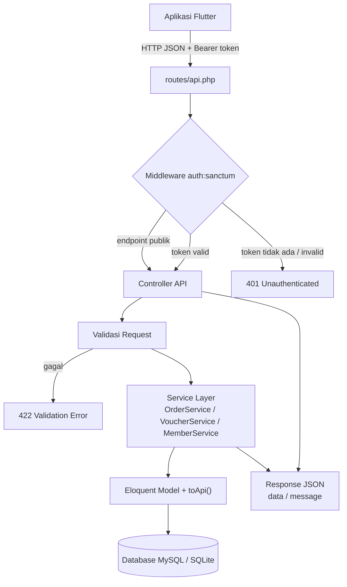
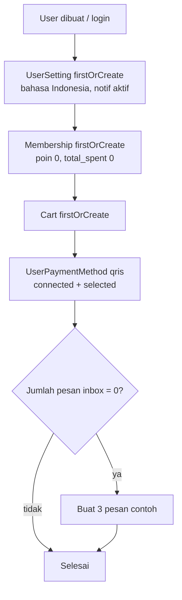
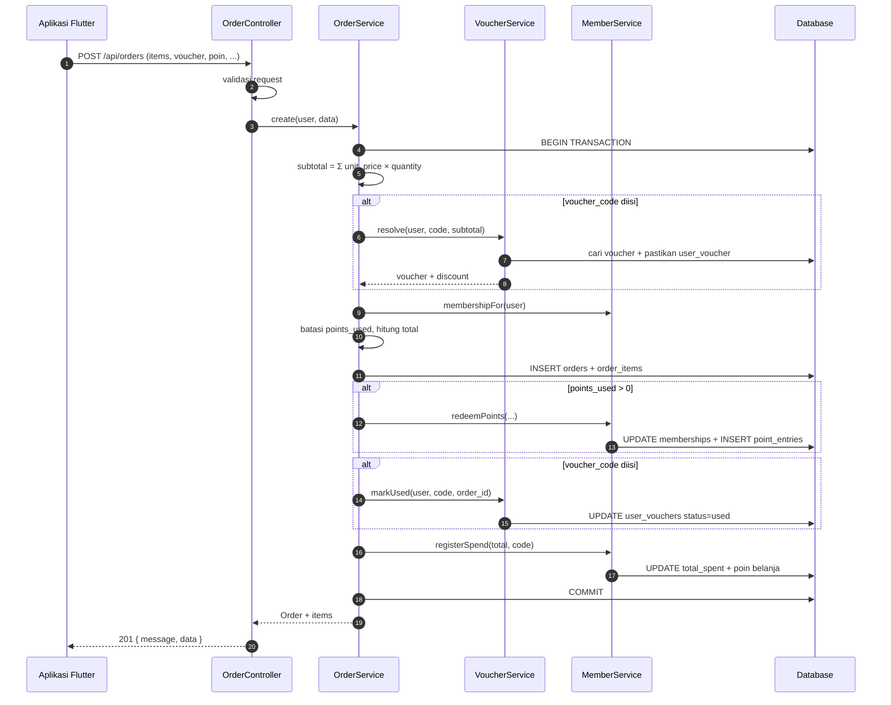
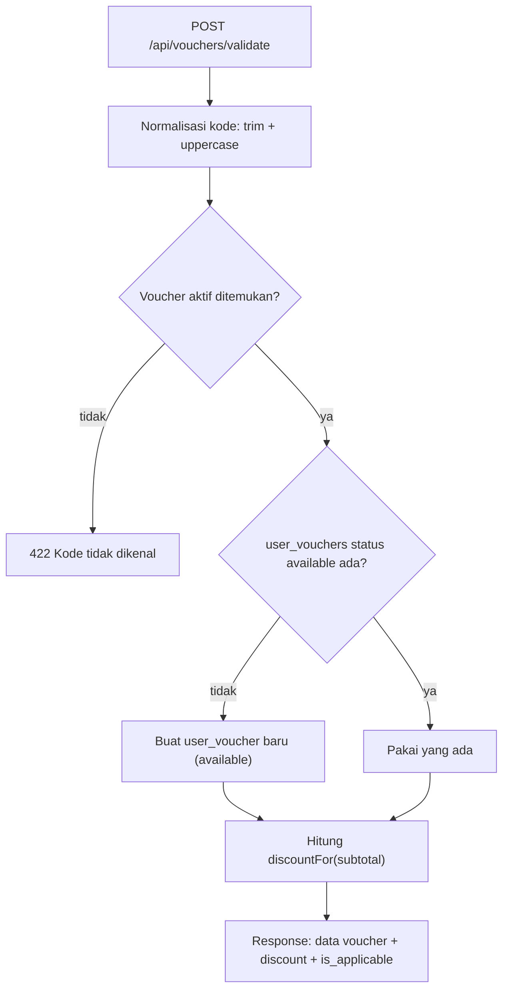
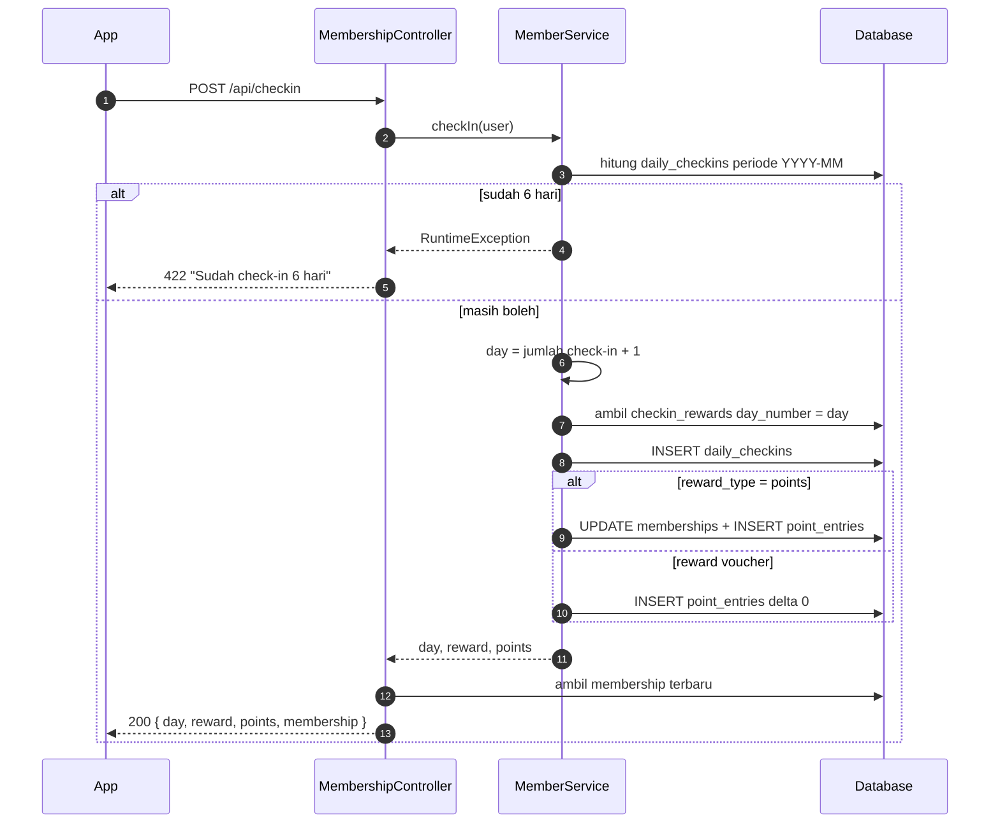
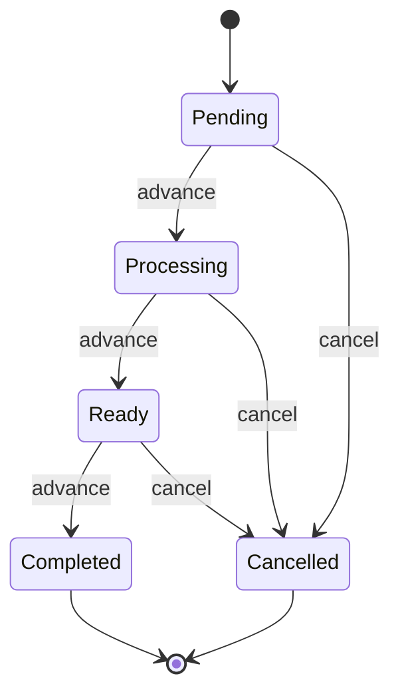

# Arsitektur Sistem Kopi Kangenan

Dokumen ini menjelaskan arsitektur backend **Kopi Kangenan**: lapisan aplikasi,
relasi data, alur bisnis utama, serta catatan teknis yang perlu diketahui saat
mengembangkan atau men-deploy sistem.

## Daftar Isi

- [1. Ringkasan Sistem](#1-ringkasan-sistem)
- [2. Alur Request](#2-alur-request)
- [3. Struktur Direktori](#3-struktur-direktori)
- [4. Lapisan & Tanggung Jawab](#4-lapisan--tanggung-jawab)
- [5. Modul Domain](#5-modul-domain)
- [6. Model Data (ERD)](#6-model-data-erd)
- [7. Alur Bisnis Utama](#7-alur-bisnis-utama)
- [8. Cross-Cutting Concern](#8-cross-cutting-concern)
- [9. Runtime & Konfigurasi](#9-runtime--konfigurasi)
- [10. Pengujian](#10-pengujian)
- [11. Catatan Teknis & Rekomendasi](#11-catatan-teknis--rekomendasi)

---

## 1. Ringkasan Sistem

Kopi Kangenan adalah aplikasi pemesanan kopi dengan klien Flutter dan backend
REST API berbasis Laravel. Backend tidak merender halaman; seluruh komunikasi
berupa JSON di bawah prefix `/api`.

| Komponen | Teknologi |
| --- | --- |
| Bahasa | PHP `^8.3` |
| Framework | Laravel `^13.17` |
| Autentikasi | Laravel Sanctum `^4.3` (Bearer token) |
| Database | MySQL (skema `kopi_kangenan`) / SQLite untuk default konfigurasi |
| Klien | Aplikasi Flutter Kopi Kangenan |
| Testing | PHPUnit `^12.5` |
| Database schema | SQL eksternal `docs/database/kopi_kangenan.sql` (repo Flutter), bukan migration Laravel |

### Prinsip desain

Backend ini adalah **cermin server-side dari store/provider Flutter**. Komentar
di kode secara eksplisit menyebut kesetaraan dengan `AuthStore`, `CartStore`,
`OrderStore`, `VoucherStore`, `MemberStore`, `PaymentStore`, `SettingsStore`,
`AddressStore`, dan `InboxStore`. Konsekuensinya:

- Nama field respons dibuat semirip mungkin dengan model Dart.
- Perhitungan harga, poin, level, dan voucher mengikuti logika aplikasi.
- Setiap model menyediakan presenter `toApi()` agar bentuk JSON konsisten dan
  tidak membocorkan kolom internal (mis. `password`).

---

## 2. Alur Request



### Penjelasan tiap tahap

1. **Routing** — `routes/api.php` mendefinisikan seluruh endpoint. Laravel
   menambahkan prefix `/api` otomatis lewat `bootstrap/app.php`
   (`withRouting(api: ...)`).
2. **Middleware** — grup publik tidak memakai guard; grup terproteksi memakai
   `auth:sanctum`. Token dibaca dari header `Authorization: Bearer ...`.
3. **Controller** — memvalidasi input dengan `$request->validate()`, mengambil
   pengguna aktif, lalu memanggil service atau model. Controller tidak memuat
   logika bisnis berat.
4. **Service** — tiga domain yang punya aturan kompleks dipisahkan ke service:
   pesanan, voucher, dan membership/poin.
5. **Model** — Eloquent menangani query dan relasi. Method `toApi()`
   menormalisasi output.
6. **Response** — selalu JSON. Error otomatis dirender JSON untuk path
   `api/*` karena `shouldRenderJsonWhen()` di `bootstrap/app.php`.

---

## 3. Struktur Direktori

```text
kopi-kangenan-api/
├── app/
│   ├── Http/
│   │   └── Controllers/
│   │       ├── Controller.php
│   │       └── Api/                  # 12 controller REST
│   │           ├── AuthController.php
│   │           ├── ProfileController.php
│   │           ├── AddressController.php
│   │           ├── CatalogController.php
│   │           ├── CartController.php
│   │           ├── VoucherController.php
│   │           ├── OrderController.php
│   │           ├── MembershipController.php
│   │           ├── PaymentController.php
│   │           ├── InboxController.php
│   │           ├── SettingsController.php
│   │           └── BulkOrderController.php
│   ├── Models/                       # 25 model Eloquent + presenter toApi()
│   ├── Services/
│   │   ├── OrderService.php          # checkout, advance, cancel
│   │   ├── VoucherService.php        # resolve, ensureOwned, markUsed
│   │   └── MemberService.php         # poin, level, check-in
│   └── Providers/AppServiceProvider.php
├── bootstrap/app.php                 # routing, middleware, error JSON
├── config/                           # konfigurasi Laravel
├── database/
│   ├── factories/UserFactory.php
│   └── seeders/DatabaseSeeder.php    # akun demo + pesanan #1001
├── routes/
│   ├── api.php                       # seluruh endpoint REST
│   ├── web.php                       # halaman welcome
│   └── console.php
├── tests/
│   └── Feature/ApiTest.php           # pengujian endpoint end-to-end
├── public/index.php                  # document root
└── docs/                             # dokumentasi (folder ini)
```

> **Tidak ada folder `database/migrations`.** Skema dibuat dari file SQL
> `docs/database/kopi_kangenan.sql` yang berada di repo aplikasi Flutter. Ini
> juga alasan test memakai `DatabaseTransactions`, bukan `RefreshDatabase`.

---

## 4. Lapisan & Tanggung Jawab

| Lapisan | Lokasi | Tanggung jawab |
| --- | --- | --- |
| Routing | `routes/api.php` | Pemetaan method + path ke controller, pengelompokan publik/proteksi |
| Middleware | `auth:sanctum` | Autentikasi token, menolak request tanpa token |
| Controller | `app/Http/Controllers/Api` | Validasi input, otorisasi kepemilikan, memilih service/model, menyusun respons |
| Service | `app/Services` | Aturan bisnis transaksional: checkout, voucher, poin/check-in |
| Model | `app/Models` | Relasi, cast tipe data, scope, perhitungan domain ringan, presenter `toApi()` |
| Seeder | `database/seeders` | Akun demo (`demo@kangenan.com` / `123456`) dan pesanan contoh `#1001` |
| Test | `tests/Feature/ApiTest.php` | Uji end-to-end seluruh alur API terhadap database MySQL |

### Pola presenter `toApi()`

Setiap model yang dikirim ke klien punya method `toApi()`. Contoh:

- `Order::toApi()` menyertakan `items` hanya bila relasi sudah di-*load*, serta
  menambahkan `is_final`.
- `Product::toApi()` menambahkan `price_label` (`Rp28.000`) dan daftar nama
  kategori.
- `Membership::toApi()` menghitung `level`, `level_progress`, dan
  `remaining_to_next_level` saat runtime.
- `UserVoucher::toApi()` menggabungkan data template voucher dengan `status`
  milik pengguna.

Pola ini menjaga kontrak JSON tetap stabil meskipun kolom database berubah.

### Pembagian controller vs service

| Domain | Ditangani service | Alasan |
| --- | --- | --- |
| Pesanan | `OrderService` | Perhitungan total, transaksi DB, poin, voucher, status |
| Voucher | `VoucherService` | Resolusi kode, kepemilikan otomatis, penandaan terpakai |
| Membership | `MemberService` | Poin, level, hadiah check-in, periode bulanan |
| Lainnya | Langsung di controller | Operasi CRUD sederhana |

---

## 5. Modul Domain

| Modul | Controller | Service | Model utama | Prefix endpoint |
| --- | --- | --- | --- | --- |
| Autentikasi | `AuthController` | - | `User`, `UserSetting`, `Membership`, `Cart`, `InboxMessage` | `/api/auth/*` |
| Profil | `ProfileController` | - | `User` | `/api/profile` |
| Alamat | `AddressController` | - | `Address` | `/api/addresses` |
| Katalog | `CatalogController` | - | `Outlet`, `Category`, `Product`, `OptionGroup`, `Option`, `StaticPage` | `/api/outlets`, `/api/categories`, `/api/products`, `/api/merch`, `/api/static-pages` |
| Keranjang | `CartController` | - | `Cart`, `CartItem` | `/api/cart` |
| Voucher & Promo | `VoucherController` | `VoucherService` | `Voucher`, `UserVoucher`, `VoucherPack`, `PromoClaim` | `/api/vouchers`, `/api/voucher-packs`, `/api/promos` |
| Pesanan | `OrderController` | `OrderService` | `Order`, `OrderItem` | `/api/orders` |
| Membership | `MembershipController` | `MemberService` | `Membership`, `PointEntry`, `DailyCheckin`, `CheckinReward` | `/api/membership`, `/api/points`, `/api/checkin` |
| Pembayaran | `PaymentController` | - | `PaymentMethod`, `UserPaymentMethod` | `/api/payment-methods` |
| Kotak Masuk | `InboxController` | - | `InboxMessage` | `/api/inbox` |
| Pengaturan | `SettingsController` | - | `UserSetting` | `/api/settings` |
| Pesanan Besar | `BulkOrderController` | - | `BulkOrderRequest` | `/api/bulk-orders` |

---

## 6. Model Data (ERD)

```mermaid
erDiagram
    USERS {
        bigint id PK
        string name
        string identifier UK
        string identifier_type
        string password
        string provider
    }
    USER_SETTINGS {
        bigint id PK
        bigint user_id FK
        string language
        boolean notif_promo
        boolean notif_pesanan
        boolean biometric
    }
    MEMBERSHIPS {
        bigint id PK
        bigint user_id FK
        int points
        bigint total_spent
    }
    ADDRESSES {
        bigint id PK
        bigint user_id FK
        string label
        string recipient
        string phone
        string detail
        boolean is_default
    }
    CARTS {
        bigint id PK
        bigint user_id FK
    }
    CART_ITEMS {
        bigint id PK
        bigint cart_id FK
        bigint product_id FK
        int quantity
        int unit_price
    }
    ORDERS {
        bigint id PK
        string code UK
        bigint user_id FK
        bigint outlet_id FK
        int subtotal
        int bag_fee
        int voucher_discount
        int points_used
        int total
        string status
    }
    ORDER_ITEMS {
        bigint id PK
        bigint order_id FK
        bigint product_id FK
        int quantity
        int unit_price
    }
    OUTLETS {
        bigint id PK
        string name
        boolean is_default
    }
    PRODUCTS {
        bigint id PK
        string name
        string slug
        int price
        string type
        boolean is_available
    }
    CATEGORIES {
        bigint id PK
        string name
        string slug
    }
    OPTION_GROUPS {
        bigint id PK
        string name
        string slug
    }
    OPTIONS {
        bigint id PK
        bigint option_group_id FK
        string name
        int extra_price
    }
    VOUCHERS {
        bigint id PK
        string code UK
        string kind
        int percent
        int amount
        int min_purchase
    }
    USER_VOUCHERS {
        bigint id PK
        bigint user_id FK
        bigint voucher_id FK
        bigint order_id FK
        string code
        string status
    }
    VOUCHER_PACKS {
        string id PK
        string title
        int price
    }
    PAYMENT_METHODS {
        string id PK
        string name
        boolean needs_connection
    }
    USER_PAYMENT_METHODS {
        bigint id PK
        bigint user_id FK
        string payment_method_id FK
        boolean is_connected
        boolean is_selected
    }
    POINT_ENTRIES {
        bigint id PK
        bigint user_id FK
        bigint order_id FK
        string title
        int delta
    }
    DAILY_CHECKINS {
        bigint id PK
        bigint user_id FK
        int day_number
        string period
        string reward_label
    }
    CHECKIN_REWARDS {
        bigint id PK
        int day_number
        string reward_label
        string reward_type
        int reward_value
    }
    INBOX_MESSAGES {
        bigint id PK
        bigint user_id FK
        string title
        string body
        string kind
    }
    PROMO_CLAIMS {
        bigint id PK
        bigint user_id FK
        string label
    }
    BULK_ORDER_REQUESTS {
        bigint id PK
        bigint user_id FK
        string name
        string contact
        int estimated_cups
        string status
    }
    STATIC_PAGES {
        bigint id PK
        string slug UK
        string title
    }
    PERSONAL_ACCESS_TOKENS {
        bigint id PK
        bigint tokenable_id FK
        string token UK
    }

    USERS ||--|| USER_SETTINGS : "punya"
    USERS ||--|| MEMBERSHIPS : "punya"
    USERS ||--|| CARTS : "punya"
    USERS ||--o{ ADDRESSES : "punya"
    USERS ||--o{ ORDERS : "membuat"
    USERS ||--o{ USER_VOUCHERS : "memiliki"
    USERS ||--o{ POINT_ENTRIES : "mencatat"
    USERS ||--o{ DAILY_CHECKINS : "check-in"
    USERS ||--o{ INBOX_MESSAGES : "menerima"
    USERS ||--o{ PROMO_CLAIMS : "klaim"
    USERS ||--o{ BULK_ORDER_REQUESTS : "mengirim"
    USERS ||--o{ USER_PAYMENT_METHODS : "menghubungkan"
    USERS ||--o{ PERSONAL_ACCESS_TOKENS : "token"

    CARTS ||--|{ CART_ITEMS : "berisi"
    PRODUCTS ||--o{ CART_ITEMS : "dirujuk"

    ORDERS ||--|{ ORDER_ITEMS : "berisi"
    PRODUCTS ||--o{ ORDER_ITEMS : "snapshot"
    OUTLETS ||--o{ ORDERS : "memenuhi"
    ORDERS ||--o{ USER_VOUCHERS : "memakai"

    PRODUCTS }o--o{ CATEGORIES : "product_categories"
    PRODUCTS }o--o{ OPTION_GROUPS : "product_option_group"
    OPTION_GROUPS ||--|{ OPTIONS : "berisi"

    VOUCHERS ||--o{ USER_VOUCHERS : "template"
    VOUCHER_PACKS }o--o{ VOUCHERS : "pack_vouchers"

    PAYMENT_METHODS ||--o{ USER_PAYMENT_METHODS : "dihubungkan"
    CHECKIN_REWARDS ||..o{ DAILY_CHECKINS : "hari ke-n (logis)"
```



### Catatan relasi

- **`users` adalah pusat data.** Hampir semua tabel transaksi memiliki
  `user_id`, sehingga otorisasi cukup membandingkan `user_id`.
- **Snapshot vs referensi.** `cart_items` dan `order_items` menyimpan nama,
  gambar, dan harga sendiri. `product_id` hanya referensi opsional agar riwayat
  tetap valid saat produk berubah atau dihapus.
- **Relasi banyak-ke-banyak.** `product_categories`,
  `product_option_group`, dan `pack_vouchers` adalah tabel pivot.
- **Level tidak disimpan.** `memberships` hanya menyimpan `points` dan
  `total_spent`; level Silver/Gold/Black dihitung dari ambang belanja.
- **Check-in berbasis periode.** `daily_checkins.period` berformat `YYYY-MM`
  sehingga kuota 6 hari otomatis reset tiap bulan. Hubungan ke
  `checkin_rewards` bersifat logis lewat `day_number`, bukan foreign key.
- **Voucher berlapis.** `vouchers` adalah template/katalog, sedangkan
  `user_vouchers` adalah salinan milik pengguna yang mencatat status
  `available`/`used`.
- **Token Sanctum** disimpan di `personal_access_tokens` dan terhubung ke
  `users` secara polimorfik (`tokenable_type`, `tokenable_id`).

---

## 7. Alur Bisnis Utama

### 7.1 Bootstrap akun baru

Dipanggil pada registrasi, login, login Google, dan `GET /api/auth/me`:



Semua langkah memakai `firstOrCreate`, jadi aman dipanggil berulang.

### 7.2 Checkout (transaksional)



Detail perhitungan:

```text
subtotal    = Σ (unit_price × quantity)
diskon      = voucher.discountFor(subtotal)
points_used = min(points_used, saldo, max(0, subtotal + bag_fee - diskon))
total       = max(0, subtotal + bag_fee - diskon - points_used)
poin_didapat= intdiv(total, 1000)
```

Jika terjadi exception, seluruh transaksi di-*rollback* sehingga poin, voucher,
dan pesanan tidak pernah setengah jadi.

### 7.3 Validasi voucher



Checkout memakai `VoucherService::resolve()` yang sama, lalu `markUsed()`
mengubah status menjadi `used` dan menyimpan `order_id`.

### 7.4 Daily Check-In



### 7.5 Siklus status pesanan



`advance` pada status final tidak mengubah apa pun dan tetap membalas `200`.
`cancel` pada status final membalas `422`. Pembatalan **tidak** mengembalikan
poin, voucher, atau `total_spent` — lihat bagian rekomendasi.

---

## 8. Cross-Cutting Concern

### 8.1 Autentikasi

- Sanctum menerbitkan token acak saat register/login; hanya hash token yang
  disimpan di database.
- `logout` menghapus token aktif saja; `logout-all` menghapus semua token
  pengguna.
- Tidak ada kedaluwarsa token eksplisit (`expiration` default `null`), sehingga
  token berlaku sampai dihapus.

### 8.2 Validasi

- Semua input divalidasi di controller dengan aturan Laravel.
- Kesalahan validasi otomatis menjadi `422` dengan struktur
  `message` + `errors`.
- Aturan bisnis yang tidak bisa diekspresikan aturan validasi (mis. saldo poin,
  voucher tidak aktif) melempar `RuntimeException`/`InvalidArgumentException`
  dan ditangkap controller menjadi `422`.

### 8.3 Otorisasi kepemilikan

Tidak ada role/admin. Setiap resource milik pengguna diperiksa manual:

```php
abort_unless($order->user_id === $request->user()->id, 404);
```

Keputusan memakai `404` (bukan `403`) bertujuan agar keberadaan resource milik
pengguna lain tidak bocor.

### 8.4 Uang dan waktu

- Semua nominal adalah **integer Rupiah**, tidak memakai `float`/`decimal`.
- Format tampilan (`Rp28.000`) dibuat di presenter (`price_label`), bukan
  disimpan di database.
- Waktu dikirim sebagai ISO 8601 (`toIso8601String()`), sedangkan beberapa
  field memakai `diffForHumans()` (`date` pada inbox dan riwayat poin).

### 8.5 Konsistensi data

- Checkout dibungkus `DB::transaction`.
- `firstOrCreate`/`updateOrCreate` dipakai untuk data awal dan relasi yang
  idempoten.
- `total_spent` dan `points` diubah lewat `MemberService`, bukan langsung dari
  controller.

---

## 9. Runtime & Konfigurasi

### 9.1 Menjalankan aplikasi

```bash
composer install
php artisan key:generate
php artisan serve
```

Dengan Laragon, arahkan document root ke folder `public/`.

### 9.2 Database

| Konteks | Konfigurasi |
| --- | --- |
| Default `config/database.php` | `sqlite` bila `DB_CONNECTION` tidak diisi |
| Test (`phpunit.xml`) | MySQL `127.0.0.1:3306`, database `kopi_kangenan`, user `root` |
| Skema | Diimpor dari `docs/database/kopi_kangenan.sql` (repo Flutter) |
| Data demo | `php artisan db:seed` (membutuhkan skema & tabel sudah ada) |

Langkah menyiapkan database:

```bash
# 1. Buat database
mysql -u root -e "CREATE DATABASE IF NOT EXISTS kopi_kangenan"

# 2. Impor skema dari repo Flutter
mysql -u root kopi_kangenan < ../kopi-kangenan/docs/database/kopi_kangenan.sql

# 3. Seed akun demo
php artisan db:seed
```

Buat `.env` (belum tersedia di repo) dengan minimal:

```dotenv
APP_NAME="Kopi Kangenan"
APP_ENV=local
APP_KEY=
APP_DEBUG=true
APP_URL=http://localhost:8000
APP_TIMEZONE=Asia/Jakarta

DB_CONNECTION=mysql
DB_HOST=127.0.0.1
DB_PORT=3306
DB_DATABASE=kopi_kangenan
DB_USERNAME=root
DB_PASSWORD=
```

### 9.3 Akun demo

| Identifier | Password | Provider |
| --- | --- | --- |
| `demo@kangenan.com` | `123456` | local |
| `pengguna.google@gmail.com` | `123456` | google |

Seeder juga membuat pesanan `#1001` berstatus `Completed` sebagai riwayat awal.

---

## 10. Pengujian

`tests/Feature/ApiTest.php` menguji alur end-to-end: autentikasi, katalog,
keranjang, alamat, voucher, checkout (termasuk voucher + poin), status pesanan,
membership, check-in, pembayaran, inbox, pengaturan, profil, dan pesanan besar.

```bash
php artisan test
```

Karakteristik:

- Memakai `DatabaseTransactions`, bukan `RefreshDatabase`, karena skema berasal
  dari SQL eksternal.
- Membutuhkan database MySQL `kopi_kangenan` yang sudah berisi skema dan data
  seed.
- Helper `forgetAuth()` dipakai saat berpindah token dalam satu test karena
  guard Laravel di-cache per test.

---

## 11. Catatan Teknis & Rekomendasi

Bagian ini mencatat kondisi nyata kode saat dokumen dibuat, bukan asumsi.

| # | Temuan | Dampak | Rekomendasi |
| --- | --- | --- | --- |
| 1 | Tidak ada `database/migrations`; skema bergantung pada file SQL repo lain | Setup dan CI rapuh, versi skema tidak terlacak di repo ini | Tambahkan migration atau submodule/artifact skema yang terversi |
| 2 | Tidak ada `.env`/`.env.example` di repo | Developer baru harus menebak konfigurasi | Tambahkan `.env.example` |
| 3 | Login Google hanya menerima `identifier`, tanpa verifikasi ID token | Siapa pun bisa masuk sebagai identifier mana pun | Verifikasi token Google (Firebase/Google Identity) di server |
| 4 | Belum ada rate limit pada login/register (`apiLimiter` tidak diatur) | Rawan brute force | Aktifkan `throttle` pada endpoint auth |
| 5 | Kode pesanan dibuat dari `max(id) + 1` | Dua checkout bersamaan bisa mendapat kode sama | Gunakan auto-increment/sequence, atau unique index + retry |
| 6 | `buyPack` langsung memberi voucher tanpa memotong pembayaran | Paket voucher gratis | Hubungkan payment gateway atau potong saldo |
| 7 | Pembatalan pesanan tidak mengembalikan poin, voucher, dan `total_spent` | Data membership bisa tidak konsisten | Buat alur refund/reversal saat cancel |
| 8 | Voucher dengan potongan 0 (di bawah `min_purchase`) tetap ditandai `used` saat checkout | Pengguna kehilangan voucher tanpa manfaat | Tolak checkout atau lewati `markUsed` bila diskon 0 |
| 9 | Item keranjang selalu ditambahkan sebagai baris baru | Duplikasi baris untuk produk/opsi sama | Gabungkan item identik di server atau tegaskan kontrak ke klien |
| 10 | `AuthController@me` ikut memanggil bootstrap dan membuat inbox contoh bila kosong | Pesan contoh bisa muncul lagi setelah semua pesan dihapus | Pisahkan bootstrap dari endpoint baca |
| 11 | Tidak ada role/admin dan tidak ada CORS config kustom | Operasi katalog hanya lewat seeder/SQL | Tambahkan admin API + policy, publish `config/cors.php` bila perlu |
| 12 | Password minimal 6 karakter | Relatif lemah | Naikkan kebijakan password, pertimbangkan verifikasi email/OTP |
| 13 | Tidak ada versioning API (`/api/v1`) | Perubahan kontrak berisiko merusak klien lama | Pertimbangkan versioning sebelum rilis publik |
