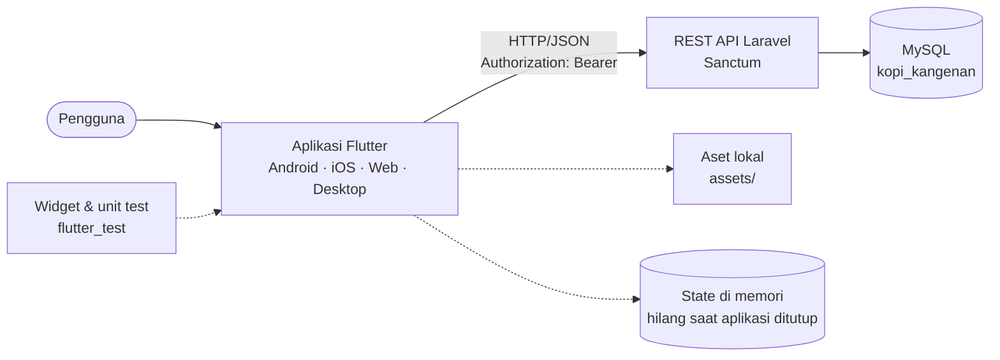
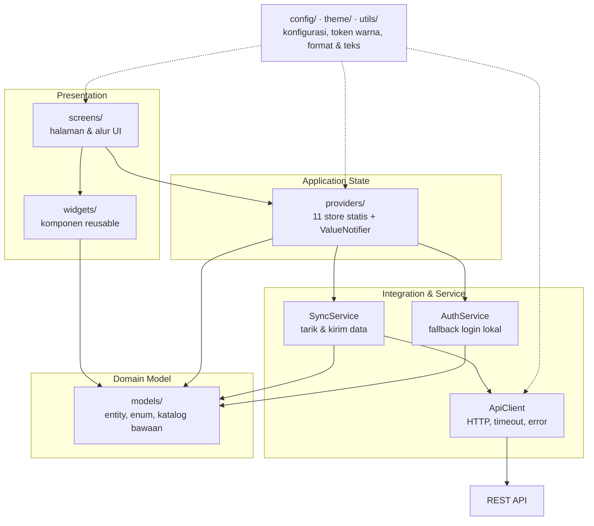
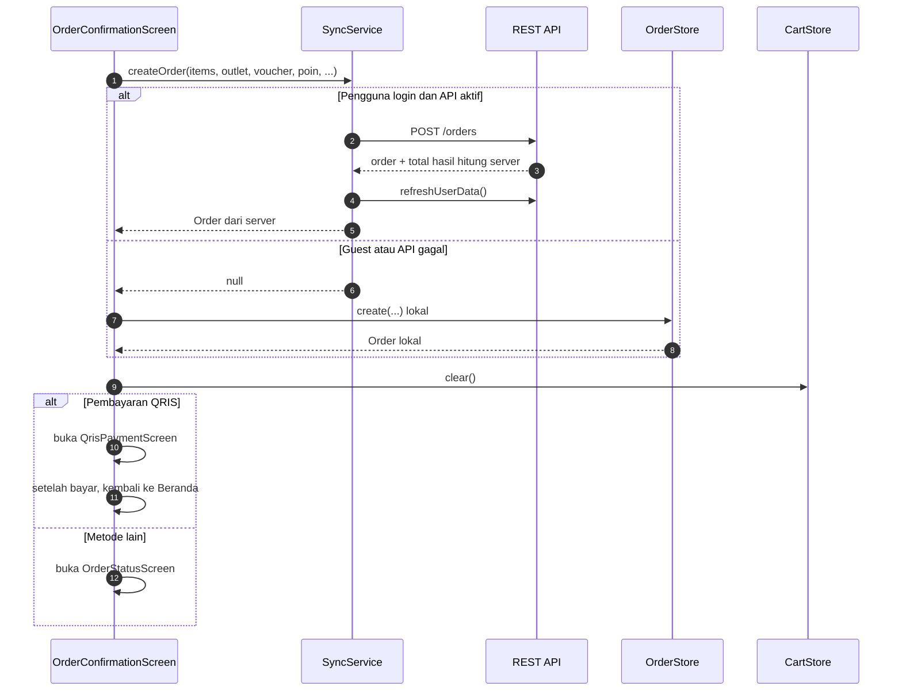

# Arsitektur Sistem — Kopi Kangenan

Dokumen ini menjelaskan arsitektur aplikasi **Kopi Kangenan** berdasarkan kode
yang ada di repositori ini. Fokusnya adalah frontend Flutter di folder `lib/`,
hubungannya dengan REST API Laravel, serta keputusan desain dan batasan yang
menyertainya.

| Atribut | Nilai |
|---|---|
| Jenis aplikasi | Client Flutter multi-platform (Android, iOS, Web, Windows, macOS, Linux) |
| Pola arsitektur | Layered architecture + local-first / offline-tolerant |
| State management | Store statis + `ValueNotifier` (tanpa package state management) |
| Backend | REST API Laravel 13 + Laravel Sanctum (proyek terpisah) |
| Database | MySQL `kopi_kangenan`, skema dikelola `docs/database/kopi_kangenan.sql` |
| Autentikasi | Bearer token Sanctum, disimpan hanya di memori |
| Navigasi | `Navigator` 1.0 dengan `MaterialPageRoute` |
| Versi aplikasi | `1.0.0+1` |
| Terakhir diperbarui | 20 Oktober 2026 |

> Dokumen terkait: [`design.md`](design.md) untuk design system,
> [`api.md`](api.md) untuk kontrak REST API, dan
> [`database/README.md`](database/README.md) untuk skema database.

---

## 1. Ringkasan

Kopi Kangenan adalah aplikasi pemesanan kopi yang terdiri dari dua sistem
terpisah:

1. **Aplikasi Flutter** (repositori ini) — menangani seluruh tampilan, state
   aplikasi, validasi awal, dan komunikasi HTTP ke API.
2. **REST API Laravel** (proyek terpisah, lihat `docs/api.md`) — menangani
   autentikasi, katalog, pesanan, voucher, membership, dan data pengguna.
   Database-nya MySQL dengan 29 tabel.

Aplikasi Flutter dirancang **local-first**: setiap store sudah memiliki nilai
awal yang valid dari `lib/models/`, lalu data disegarkan dari API saat aplikasi
dibuka atau setelah pengguna masuk. Jika API mati atau lambat, aplikasi tetap
dapat menampilkan katalog dan membuat pesanan secara lokal. Karena itu, aplikasi
tidak bergantung pada ketersediaan jaringan untuk bisa dibuka.

Karakteristik utama:

- Seluruh state hanya hidup **di memori**; tidak ada database lokal, file
  preferensi, atau secure storage.
- Token dan sesi juga hanya di memori; menutup aplikasi berarti keluar.
- Layar tidak memanggil HTTP secara langsung. Komunikasi API dipusatkan di
  `ApiClient` dan `SyncService`.
- Perubahan data lokal langsung ditampilkan, lalu dikirim ke API tanpa
  ditunggu (`unawaited`).
- Server tetap menjadi otoritas untuk perhitungan harga dan diskon saat pesanan
  dibuat.

---

## 2. Ruang Lingkup dan Prinsip

### 2.1 Ruang lingkup repositori

Repositori ini hanya berisi **frontend Flutter**. Backend Laravel tidak berada
di dalam repositori, tetapi kontraknya didokumentasikan di `docs/api.md`.

```text
Repositori ini                         Proyek terpisah
┌──────────────────────────┐          ┌──────────────────────────┐
│ kopken_clone (Flutter)   │  HTTP    │ kopi-kangenan-api        │
│ lib/, test/, assets/     │ ───────► │ (Laravel + Sanctum)      │
└──────────────────────────┘          └────────────┬─────────────┘
                                                   │
                                                   ▼
                                          ┌──────────────────┐
                                          │ MySQL            │
                                          │ kopi_kangenan    │
                                          └──────────────────┘
```

### 2.2 Prinsip yang dipegang

| Prinsip | Penerapan |
|---|---|
| Tampilan tetap jalan tanpa API | Nilai awal katalog dan data contoh ada di `lib/models/` |
| Satu sumber kebenaran untuk setiap state | Satu store statis per domain, dibaca lewat `ValueNotifier` |
| Pemisahan UI dan jaringan | Layar membaca store; HTTP hanya lewat service |
| Server otoritatif untuk transaksi | Harga, diskon, poin, dan total pesanan dihitung ulang di server |
| Dependency minimal | Hanya `http` dan `cupertino_icons` di luar Flutter SDK |
| Konsistensi visual | Warna dan komponen bersama di `theme/` dan `widgets/` |
| Data sensitif tidak persisten | Token dan sesi hanya di memori |

---

## 3. Stack Teknologi

| Lapisan | Teknologi | Keterangan |
|---|---|---|
| Bahasa | Dart SDK `^3.13.2` | Lihat `pubspec.yaml` |
| Framework UI | Flutter, Material 3 | Tema dibuat di `main.dart` |
| HTTP client | `http ^1.2.2` | Satu-satunya dependency runtime tambahan |
| Model JSON | Manual (`Map<String, dynamic>`) | Tidak memakai `json_serializable` |
| State | `ValueNotifier` + `ValueListenableBuilder` | Tidak memakai Provider/Riverpod/Bloc |
| Backend | Laravel 13.37 + Sanctum | Proyek terpisah |
| Database | MySQL `kopi_kangenan` | Skema dari file SQL, bukan migration |
| Lint | `flutter_lints ^6.0.0` | Konfigurasi di `analysis_options.yaml` |
| Test | `flutter_test` | 5 berkas tes di `test/` |

Platform yang sudah disiapkan di repositori: Android, iOS, Web, Windows, macOS,
dan Linux.

---

## 4. Konteks Sistem



### Aktor dan sistem eksternal

| Aktor / Sistem | Peran |
|---|---|
| Pengguna | Melihat katalog, memesan, mengelola akun, voucher, poin, dan alamat |
| Aplikasi Flutter | Menyajikan UI, menyimpan state sementara, dan mengirim/menarik data |
| REST API Laravel | Validasi, autentikasi, otorisasi, dan penyimpanan data permanen |
| MySQL | Penyimpanan data katalog, pengguna, pesanan, voucher, dan lainnya |
| Google Sign-In | **Disimulasikan** lewat endpoint `/auth/login/google`; tidak ada SDK Google |

---

## 5. Arsitektur Berlapis



### Tanggung jawab lapisan

| Lapisan | Lokasi | Tanggung jawab | Aturan |
|---|---|---|---|
| Bootstrap & navigasi | `main.dart`, `screens/splash/`, `screens/navigation/` | Memulai aplikasi, memuat katalog awal, menampilkan shell utama | Tidak berisi logika bisnis |
| Presentasi | `screens/` | Menyusun halaman, menangani input pengguna, menampilkan state | Tidak memanggil `http` langsung |
| Komponen UI | `widgets/` | Komponen reusable seperti kartu produk, tombol, sheet, header | Tidak menyimpan state domain |
| State aplikasi | `providers/` | Menyimpan dan mengubah state domain, memicu sinkronisasi | Satu store per domain |
| Integrasi | `services/` | HTTP client, orkestrasi sinkronisasi, autentikasi | Tidak mengimpor `screens/` atau `widgets/` |
| Domain | `models/` | Entity, enum, aturan kecil, dan data katalog bawaan | Tidak memanggil API |
| Cross-cutting | `config/`, `theme/`, `utils/` | Base URL, token, warna, format Rupiah, teks bahasa | Dipakai lintas lapisan |

### Aturan dependensi

1. **Layar → store → service → API.** Layar tidak boleh membuat request HTTP
   sendiri.
2. **Service tidak boleh mengimpor layar atau widget.** Arah dependensi selalu
   dari presentasi ke domain/integrasi.
3. **Model tidak boleh memanggil API.** Model hanya berisi data dan aturan
   turunan sederhana (mis. `CartItem.totalPrice`,
   `Voucher.discountFor()`).
4. **Satu-satunya pemanggilan service langsung dari layar** adalah
   `OrderConfirmationScreen._buatPesanan()` yang memanggil
   `SyncService.createOrder` karena layar membutuhkan objek `Order` hasil
   transaksi. Pemanggilan HTTP-nya tetap berada di dalam service.
5. **Store lokal adalah sumber kebenaran tampilan.** Perubahan lokal diterapkan
   lebih dulu, lalu dikirim ke server.

> Catatan: sebagian model membawa informasi presentasi. `OrderStatus`
> menyimpan `Color`, dan `PaymentMethod` menyimpan `IconData`. Ini trade-off
> agar layar tidak menduplikasi pemetaan status/metode pembayaran.

---

## 6. Struktur Direktori

```text
lib/                              (71 berkas Dart)
├── main.dart                     Entry point, MaterialApp, tema global
├── config/
│   └── api.dart                  ApiConfig: base URL, enabled, token, canSync
├── models/                       (10 berkas)
│   ├── address.dart              Address
│   ├── cart.dart                 CartItem + aturan kustomisasi
│   ├── inbox.dart                InboxMessage, InboxKind
│   ├── merch.dart                MerchProduct, katalog merch bawaan
│   ├── order.dart                Order, OrderStatus
│   ├── outlet.dart               Outlet, FulfilmentMode, katalog outlet
│   ├── payment_method.dart       PaymentMethod, katalog metode pembayaran
│   ├── point_entry.dart          PointEntry
│   ├── product.dart              Product, kategori minuman, katalog menu
│   └── voucher.dart              Voucher, VoucherKind, VoucherPack
├── providers/                    (11 store)
│   ├── address_store.dart
│   ├── auth_store.dart
│   ├── cart_store.dart
│   ├── catalog_store.dart
│   ├── inbox_store.dart
│   ├── member_store.dart
│   ├── order_store.dart
│   ├── outlet_store.dart
│   ├── payment_store.dart
│   ├── settings_store.dart
│   └── voucher_store.dart
├── services/
│   ├── api_client.dart           Pembungkus HTTP + ApiException
│   ├── auth_service.dart         Login/daftar lokal (fallback & test)
│   └── sync_service.dart         Tarik data & kirim perubahan ke API
├── screens/                      (32 berkas di 13 folder)
│   ├── splash/
│   ├── auth/                     Panel Login/Daftar
│   ├── navigation/               Shell utama & pembuka panel login
│   ├── home/
│   ├── menu/
│   ├── product/
│   ├── cart/
│   ├── checkout/                 Konfirmasi, metode bayar, QRIS, voucher pack
│   ├── order/                    Status & riwayat pesanan
│   ├── outlet/
│   ├── vip/
│   ├── merch/                    Katalog, detail, scan QR
│   └── profile/                  Data diri, alamat, inbox, poin, check-in, dll.
├── theme/
│   └── app_colors.dart           Token warna tunggal
├── utils/
│   ├── currency.dart             formatRupiah(), formatAngka()
│   └── strings.dart              AppLanguage + Strings
└── widgets/                      (10 komponen bersama)
    ├── ui.dart                   AppPage, AppCard, AppPrimaryButton, dll.
    ├── auth_panel.dart
    ├── category_tabs.dart
    ├── checkout_sheets.dart
    ├── diskon_cashback_section.dart
    ├── kangenan_coin.dart
    ├── mobile_frame.dart
    ├── outlet_card.dart
    ├── product_card.dart
    └── section_header.dart
```

### Catatan struktur

- `screens/navigation/main_navigation_screen.dart` adalah **shell aktif** dengan
  5 tab.
- `screens/home/main_navigation_screen.dart` adalah versi lama yang tidak
  diimpor oleh kode mana pun. File ini dapat dihapus pada pembersihan berikutnya.
- `widgets/mobile_frame.dart` menyediakan bingkai 390 × 844 untuk web/desktop,
  tetapi belum dipakai sebagai pembungkus root.
- `config/api.dart` tidak kosong; file ini menyimpan konfigurasi API dan token.

---

## 7. Komponen Inti

### 7.1 Entry point dan shell

| Komponen | Berkas | Peran |
|---|---|---|
| `KopkenApp` | `lib/main.dart` | Membuat `MaterialApp`, tema Material 3, `home: SplashScreen` |
| `SplashScreen` | `screens/splash/splash_screen.dart` | Menampilkan logo minimal 3 detik sambil menjalankan `SyncService.bootstrap()` |
| `LoginHomeScreen` | `screens/navigation/login_home_screen.dart` | Menampilkan `MainNavigationScreen`, lalu membuka panel login otomatis |
| `MainNavigationScreen` | `screens/navigation/main_navigation_screen.dart` | Shell 5 tab: Beranda, Menu, VIP, Merch, Saya |
| `showAuthSheet()` | `screens/auth/auth_sheet.dart` | Bottom sheet login/daftar yang tidak bisa ditutup lewat area gelap |

### 7.2 Store dan state yang dimiliki

| Store | State utama | Sifat | Sinkronisasi |
|---|---|---|---|
| `AuthStore` | `currentUser` | Sesi login | Login/daftar/profil lewat API; fallback lokal |
| `CatalogStore` | `menu`, `merch`, `outlets` | Katalog | Tarik dari API saat bootstrap |
| `CartStore` | `items` | Keranjang | **Tidak disinkronkan** |
| `OutletStore` | `selected`, `mode` | Outlet & Pickup/Delivery | Outlet default dari API |
| `AddressStore` | `addresses` | Alamat | Tarik & kirim tambah/hapus |
| `MemberStore` | `points`, `totalSpent`, `checkedDays`, `history` | Membership & poin | Tarik & kirim check-in |
| `VoucherStore` | `userVouchers`, `claimedPromos`, `ownedPacks` | Voucher & promo | Tarik & kirim klaim/beli/kode |
| `OrderStore` | `orders` | Riwayat pesanan lokal | Tarik & kirim status |
| `InboxStore` | `messages` | Kotak masuk | Tarik & kirim status baca |
| `PaymentStore` | `selectedId`, `connectedIds` | Metode pembayaran | Tarik & kirim pilihan/koneksi |
| `SettingsStore` | `language`, `notifPromo`, `notifPesanan`, `biometric` | Preferensi | Tarik & kirim pengaturan |

Semua state di atas hilang saat proses aplikasi berhenti. Tidak ada mekanisme
restore sesi dari disk.

### 7.3 Service

| Service | Tanggung jawab |
|---|---|
| `ApiClient` | GET/POST/PUT/DELETE, header JSON + Bearer, timeout 15 detik, decode respons, melempar `ApiException` berbahasa Indonesia |
| `AuthService` | Validasi email/nomor HP/password/nama, akun demo, login/daftar lokal di memori |
| `SyncService` | `bootstrap`, `loadCatalog`, `refreshUserData`, `createOrder`, dan seluruh `push...` ke API |

### 7.4 Model dan data bawaan

`models/` tidak hanya berisi entity, tetapi juga **fallback statis**:

- `kProductCatalog` — katalog menu bawaan.
- `kMerchCatalog` — katalog merchandise bawaan.
- `kOutlets` dan `kDefaultOutlet` — outlet bawaan.
- `kPaymentMethods` — metode pembayaran.
- `kVoucherPacks` dan `VoucherStore.catalog` — paket dan voucher contoh.
- `dailyRewards` — hadiah check-in 6 hari.

Data ini membuat aplikasi tetap tampil utuh saat API tidak tersedia.

---

## 8. Alur Runtime

### 8.1 Startup

```mermaid
sequenceDiagram
    autonumber
    participant Splash as SplashScreen
    participant Sync as SyncService
    participant API as REST API
    participant Catalog as CatalogStore
    participant Login as LoginHomeScreen
    participant Nav as MainNavigationScreen

    Splash->>Sync: bootstrap()
    alt ApiConfig.enabled = true
        Sync->>API: GET /products?type=menu
        Sync->>API: GET /merch
        Sync->>API: GET /outlets
        alt Respons berhasil dan tidak kosong
            API-->>Sync: JSON
            Sync->>Catalog: perbarui menu, merch, outlet
        else Gagal / timeout
            Sync-->>Sync: debugPrint; pertahankan data bawaan
        end
    end
    Splash->>Splash: tunggu minimal 3 detik
    Splash->>Login: pushReplacement
    Login->>Nav: render shell
    Login->>Login: showAuthSheet() setelah frame pertama
```

Panel login dapat ditutup dengan tombol X. Setelah ditutup, pengguna memakai
aplikasi sebagai **Guest** tanpa sinkronisasi pengguna.

### 8.2 Login dan pembentukan sesi

1. Panel login memanggil `AuthStore.signIn`, `signUp`, atau
   `signInWithGoogle`.
2. `AuthStore` mengirim request ke `/auth/*` melalui `ApiClient`.
3. Respons berisi `token` dan `user`. Token disimpan di `ApiConfig.token`,
   pengguna di `AuthStore.currentUser`.
4. `AuthStore` memanggil `SyncService.refreshUserData()` tanpa menunggu
   (`unawaited`). Data membership, pesanan, voucher, alamat, inbox, pengaturan,
   dan metode pembayaran ditarik dari server.
5. Jika `ApiConfig.enabled = false` (dipakai tes), jalur lokal `AuthService`
   dipakai sebagai gantinya.

`AuthStore.logout()` mengirim `POST /auth/logout` tanpa menunggu, lalu
mengosongkan `ApiConfig.token` dan `AuthStore.currentUser`.

### 8.3 Checkout dan pembuatan pesanan



Poin penting:

- Perhitungan `total` di server:
  `subtotal + bag_fee - voucher_discount - points_used`, tidak boleh negatif.
- Server juga memotong poin, menandai voucher terpakai, mencatat
  `total_spent`, dan memberi poin `total ÷ 1000`.
- Fallback lokal `OrderStore.create()` memakai aturan yang sama.
- Keranjang selalu dikosongkan setelah pesanan berhasil dibuat, baik lokal
  maupun remote.

### 8.4 Perubahan data setelah login

Pola umum untuk mutasi:

```text
Aksi pengguna
   ↓
Store mengubah nilai lokal (UI langsung berubah)
   ↓
Store memanggil SyncService.push... dengan unawaited
   ↓
ApiClient mengirim request
   ↓
Berhasil: diam / refresh data terkait
Gagal: error dicatat lewat debugPrint, state lokal tetap dipakai
```

| Fitur | Fungsi sinkronisasi |
|---|---|
| Status pesanan | `pushOrderAdvance`, `pushOrderCancel` |
| Daily check-in | `pushCheckIn` |
| Klaim promo | `pushPromoClaim` |
| Beli paket voucher | `pushBuyVoucherPack` |
| Validasi kode voucher | `pushVoucherCode` |
| Tambah / hapus alamat | `pushAddressCreate`, `pushAddressDelete` |
| Baca inbox | `pushInboxRead`, `pushInboxReadAll` |
| Pengaturan | `pushSettings` |
| Metode pembayaran | `pushPaymentSelect`, `pushPaymentConnect` |

### 8.5 Refresh data pengguna

`SyncService.refreshUserData()` menarik data secara berurutan:

1. `/membership` dan `/points/history`, plus `/checkin`.
2. `/orders`.
3. `/vouchers` dan `/promos`.
4. `/addresses`.
5. `/inbox`.
6. `/settings`.
7. `/payment-methods`.

Setiap bagian dibungkus `_guard()` sehingga kegagalan satu endpoint tidak
menghentikan bagian lain. Data yang berhasil ditarik langsung menggantikan nilai
store terkait.

---

## 9. State Management

### 9.1 Pola yang dipakai

Setiap store adalah kelas dengan konstruktor privat, state berupa
`static final ValueNotifier`, dan method statis untuk mengubah state.

```dart
class ContohStore {
  ContohStore._();

  static final ValueNotifier<int> nilai = ValueNotifier<int>(0);

  static void set(int berikutnya) {
    nilai.value = berikutnya;
  }
}
```

Layar mendengarkan perubahan dengan `ValueListenableBuilder` atau
`AnimatedBuilder`. Tidak ada `InheritedWidget` khusus, `Provider`, `Bloc`, atau
dependency injection container.

### 9.2 Konsekuensi

**Kelebihan:**

- Tidak ada dependency state management tambahan.
- Alur data mudah dilacak: layar → store → service.
- Store dapat diuji langsung tanpa widget.
- Nilai awal domain sudah tersedia sebelum API merespons.

**Keterbatasan:**

- State bersifat global dan hidup selama proses aplikasi.
- Tidak ada mekanisme persistensi atau restore otomatis.
- Store harus di-reset manual pada pengujian (`reset()`).
- Tidak ada selektor granular; perubahan `ValueNotifier` membangun ulang
  seluruh widget yang mendengarkannya.
- Logout tidak mengosongkan seluruh store domain secara eksplisit.

---

## 10. Integrasi REST API

### 10.1 Konfigurasi

`lib/config/api.dart` menyediakan:

| Anggota | Fungsi |
|---|---|
| `ApiConfig.baseUrl` | Base URL, default `http://127.0.0.1:8000/api`, dapat diubah lewat `--dart-define=API_BASE_URL=...` |
| `ApiConfig.enabled` | Saklar global API; `false` membuat aplikasi memakai jalur lokal penuh |
| `ApiConfig.token` | Bearer token Sanctum di memori |
| `ApiConfig.hasToken` | `true` jika token tersedia |
| `ApiConfig.canSync` | `enabled && hasToken` |

Contoh menjalankan dengan alamat API lain:

```powershell
flutter run -d chrome --dart-define=API_BASE_URL=http://192.168.1.10:8000/api
```

### 10.2 ApiClient

`ApiClient` menyediakan `get`, `post`, `put`, dan `delete`.

- Header: `Accept: application/json`, `Content-Type: application/json`, dan
  `Authorization: Bearer <token>` jika ada token.
- Timeout: 15 detik.
- Respons sukses: `Map<String, dynamic>` hasil decode JSON.
- Respons gagal: melempar `ApiException` dengan pesan dari `message` atau
  kesalahan validasi pertama.
- Helper `dataOf()` dan `listOf()` membaca bagian `data` dari respons.

### 10.3 Kontrak respons

```json
{
  "message": "Pesan untuk pengguna.",
  "data": {}
}
```

Kode status yang dipakai: `200`, `201`, `401`, `404`, dan `422`.

### 10.4 Peta endpoint yang dipakai klien

| Fitur | Endpoint |
|---|---|
| Login / daftar / login Google | `POST /auth/login`, `/auth/register`, `/auth/login/google` |
| Logout | `POST /auth/logout` |
| Profil & password | `PUT /profile`, `PUT /profile/password` |
| Katalog | `GET /products?type=menu`, `/merch`, `/outlets` |
| Membership | `GET /membership`, `/points/history`, `/checkin` |
| Check-in | `POST /checkin` |
| Pesanan | `GET /orders`, `POST /orders`, `PUT /orders/{id}/advance`, `PUT /orders/{id}/cancel` |
| Voucher | `GET /vouchers`, `POST /vouchers/validate`, `POST /voucher-packs/{id}/buy` |
| Promo | `GET /promos`, `POST /promos/claim` |
| Alamat | `GET /addresses`, `POST /addresses`, `DELETE /addresses/{id}` |
| Inbox | `GET /inbox`, `PUT /inbox/{id}/read`, `PUT /inbox/read-all` |
| Pengaturan | `GET /settings`, `PUT /settings` |
| Pembayaran | `GET /payment-methods`, `PUT /payment-methods/select`, `POST /payment-methods/{id}/connect` |

Endpoint lain yang tersedia di API tetapi belum dipakai klien antara lain
keranjang (`/cart`), halaman statis (`/static-pages`), dan pesanan besar
(`/bulk-orders`). Detail lengkap ada di [`api.md`](api.md).

### 10.5 Strategi offline

**Yang sudah ditangani:**

- Katalog memiliki fallback statis di `models/`.
- `SyncService` menangkap semua error dan hanya mencatatnya lewat
  `debugPrint`.
- Pesanan dapat dibuat lokal jika API tidak tersedia.
- Data pengguna yang sudah ada di memori tetap ditampilkan meski refresh gagal.

**Yang belum ditangani:**

- Tidak ada antrean request offline.
- Tidak ada retry otomatis atau backoff.
- Tidak ada penyimpanan lokal, sehingga restart aplikasi menghapus semua data.
- Tidak ada idempotency key untuk mencegah duplikasi pesanan bila respons
  server hilang setelah pesanan dibuat.
- Mutasi fire-and-forget bisa hilang tanpa pemberitahuan jika jaringan gagal.

Dengan demikian, istilah yang lebih tepat adalah **local-first dengan fallback
statis**, bukan sinkronisasi offline penuh.

---

## 11. Model Domain dan Aturan Bisnis

### 11.1 Pemetaan domain

| Domain | Model / Store | Representasi server |
|---|---|---|
| Pengguna | `AuthUser`, `AuthService._Account`, `AuthStore` | `users` |
| Preferensi | `SettingsStore` | `user_settings` |
| Alamat | `Address`, `AddressStore` | `addresses` |
| Outlet | `Outlet`, `OutletStore` | `outlets` |
| Katalog | `Product`, `CatalogStore.menu` | `products`, `categories`, `product_categories` |
| Merchandise | `MerchProduct`, `CatalogStore.merch` | `products` dengan `type = 'merch'` |
| Keranjang | `CartItem`, `CartStore` | `carts`, `cart_items` (tidak dipakai klien) |
| Pesanan | `Order`, `OrderStore` | `orders`, `order_items` |
| Voucher | `Voucher`, `VoucherPack`, `VoucherStore` | `vouchers`, `voucher_packs`, `user_vouchers` |
| Promo | `VoucherStore.claimedPromos` | `promo_claims` |
| Membership | `MemberStore` | `memberships`, `point_entries`, `daily_checkins` |
| Inbox | `InboxMessage`, `InboxStore` | `inbox_messages` |
| Pembayaran | `PaymentMethod`, `PaymentStore` | `payment_methods`, `user_payment_methods` |

### 11.2 Aturan uang dan poin

- Semua nominal adalah **integer rupiah**, tanpa desimal.
- Format tampilan memakai `formatRupiah()` (`28000` → `Rp28.000`).
- 1 poin bernilai Rp1 saat dipakai.
- Poin didapat `total ÷ 1000` per pesanan.
- Total pesanan:
  `subtotal + biaya kantung - diskon voucher - poin yang dipakai`.
- Level membership dihitung dari `totalSpent`, bukan disimpan:
  - `< Rp700.000` → Silver
  - `≥ Rp700.000` → Gold
  - `≥ Rp9.999.999` → Black
- Check-in maksimal 6 hari per bulan; hadiah ditentukan `MemberStore.dailyRewards`.

### 11.3 Identitas lokal vs server

- `Order` memakai kode tampilan seperti `#1001` sebagai `id`.
- `SyncService` menyimpan peta `kode pesanan → id numerik server` di
  `_remoteOrderIds` untuk memanggil `advance`/`cancel`.
- `Address` dan `InboxMessage` memakai ID lokal (`addr-1`, `msg-1`) yang
  dipetakan ke ID server di `_remoteIds`.
- Pemetaan ID dibangun ulang setiap kali data ditarik dari server.

### 11.4 Database

Skema database dimiliki oleh `docs/database/kopi_kangenan.sql` (29 tabel).
Struktur ini **bukan** dikelola migration Laravel. Jangan menjalankan
`php artisan migrate` pada proyek API. Detail peta model Dart → tabel ada di
[`database/README.md`](database/README.md).

---

## 12. Navigasi dan UI

### 12.1 Struktur navigasi

```text
SplashScreen
   └─ pushReplacement → LoginHomeScreen
         ├─ MainNavigationScreen (latar)
         └─ showAuthSheet() (modal Login/Daftar)

MainNavigationScreen
   ├─ Tab 0: Beranda
   ├─ Tab 1: Menu
   ├─ Tab 2: VIP
   ├─ Tab 3: Merch
   └─ Tab 4: Saya / Profil
```

Alur utama pemesanan:

```text
Beranda / Menu
   → Detail Produk
   → Keranjang
   → Checkout (OrderConfirmationScreen)
   → Metode Pembayaran / QRIS
   → Status Pesanan
```

Alur lain:

- Profil → Data Diri, Alamat, Kotak Masuk, Riwayat Poin, Daily Check-In,
  Bahasa, Pengaturan Notifikasi, Pesanan Besar, Halaman Statis.
- VIP → Voucher, Paket Voucher, Benefit.
- Merch → Detail Merchandise → Keranjang, atau Scan QR.

Navigasi memakai `Navigator` 1.0 dan `MaterialPageRoute`. Tidak ada named
route, router deklaratif, atau deep link.

### 12.2 Prinsip UI

- Material 3 dengan warna utama maroon `#7A263D`.
- Warna hanya diambil dari `AppColors`; layar tidak menulis `Color(0x...)`.
- Komponen bersama di `widgets/ui.dart` menjaga konsistensi header, kartu,
  tombol, empty state, dan bottom bar.
- Layout dibatasi sekitar 390–480 px pada shell dan halaman tertentu.
- Design system lengkap ada di [`design.md`](design.md).

---

## 13. Keamanan

| Aspek | Implementasi saat ini | Catatan |
|---|---|---|
| Autentikasi | Sanctum Personal Access Token | Dikirim sebagai Bearer token |
| Penyimpanan token | Memori (`ApiConfig.token`) | Hilang saat aplikasi ditutup |
| Password | Divalidasi di klien, diverifikasi server | `AuthService` lokal hanya untuk fallback/test |
| Otorisasi | Dilakukan server berdasarkan token | Klien tidak menyimpan aturan akses |
| Integritas harga | Server menghitung ulang total pesanan | Klien tidak dipercaya untuk total final |
| Transport | HTTP lokal saat pengembangan | Produksi wajib HTTPS |
| CORS | Diaktifkan pada API untuk `api/*` | Konfigurasi ada di proyek Laravel |
| Rahasia | Tidak ada API key rahasia di aplikasi | Hanya base URL |

Risiko yang perlu diperhatikan:

- Token di memori memang mengurangi risiko pencurian dari disk, tetapi setiap
  restart memaksa login ulang.
- Base URL HTTP hanya cocok untuk pengembangan lokal.
- Kredensial demo terdokumentasi dan hanya untuk pengembangan.

---

## 14. Reliability dan Penanganan Error

| Lapisan | Mekanisme |
|---|---|
| HTTP | Timeout 15 detik; error jaringan diubah menjadi pesan Indonesia |
| API | `ApiException` membawa pesan server dan status code |
| Sinkronisasi | `_guard()` menangkap error dan mencatat `debugPrint` |
| Katalog | Hanya diperbarui jika respons berisi data; jika kosong, fallback dipertahankan |
| Checkout | Jika API gagal, pesanan dibuat lokal |
| UI | Error ditampilkan lewat `SnackBar` atau pesan validasi |
| Tes | `ApiConfig.enabled = false` memastikan tes tidak menyentuh jaringan |

Pola ini membuat aplikasi tahan terhadap API yang mati, tetapi belum menjamin
konsistensi jangka panjang karena tidak ada antrean, retry, atau rekonsiliasi
otomatis.

---

## 15. Pengujian

| Berkas | Cakupan |
|---|---|
| `test/widget_test.dart` | Splash → Beranda, label bottom navigation |
| `test/layout_test.dart` | Regresi overflow Beranda, Menu, Profil pada 390 × 844 |
| `test/auth_test.dart` | Validasi, alur login/daftar, panel auth, logout |
| `test/store_test.dart` | Cart, outlet, membership, voucher, order, alamat, inbox, pembayaran, pengaturan |
| `test/flow_test.dart` | Alur keranjang → checkout → QRIS, opsi minuman, profil, outlet, check-in |

Prinsip pengujian:

- Semua tes widget mengeset `ApiConfig.enabled = false` agar tidak membutuhkan
  jaringan.
- Store di-reset di `setUp` agar setiap tes mulai dari keadaan yang sama.
- Tes layout memastikan tidak ada overflow pada ukuran layar ponsel.

Perintah verifikasi:

```powershell
flutter analyze
flutter test
flutter build web --release --no-wasm-dry-run
```

Pengujian backend terpisah ada di proyek Laravel:

```powershell
cd D:\laragon\www\kopi-kangenan-api
php artisan test
```

---

## 16. Build dan Deployment

### 16.1 Menjalankan aplikasi

```powershell
flutter pub get

# Web
flutter run -d chrome --dart-define=API_BASE_URL=http://127.0.0.1:8000/api

# Windows
flutter run -d windows

# Android
flutter run
```

### 16.2 Build

```powershell
flutter build apk        # Android
flutter build web        # Web
flutter build windows    # Windows
```

### 16.3 Ketergantungan runtime

Aplikasi membutuhkan REST API yang berjalan agar data pengguna dan transaksi
tersedia. Tanpa API, aplikasi tetap dapat dibuka dan dipakai dengan data
bawaan serta pesanan lokal.

### 16.4 Catatan environment

- `API_BASE_URL` diubah lewat `--dart-define`, bukan dengan mengedit kode.
- Untuk perangkat fisik, gunakan IP LAN komputer yang menjalankan API, bukan
  `127.0.0.1`.
- Build Android membutuhkan Java 17+ dan pengaturan memori Gradle yang cukup.

---

## 17. Keputusan Arsitektur

| # | Keputusan | Alasan | Konsekuensi |
|---|---|---|---|
| 1 | Frontend dan backend dipisah | Memungkinkan client lain dan deployment independen | Perlu menjaga kontrak API |
| 2 | Flutter untuk semua platform | Satu basis kode untuk mobile, web, dan desktop | Ukuran aplikasi dan kebutuhan platform tetap berbeda |
| 3 | State statis + `ValueNotifier` | Sederhana, tanpa dependency tambahan, mudah diuji | State global, tanpa persistensi, selektor kasar |
| 4 | Local-first dengan fallback statis | Aplikasi tetap bisa dibuka saat API mati | Data bisa tidak segar; tidak ada rekonsiliasi |
| 5 | Server menghitung ulang total | Mencegah manipulasi harga dari klien | Klien dan server harus menjaga aturan yang sama |
| 6 | Token hanya di memori | Mengurangi risiko token tersimpan di disk | Pengguna harus login ulang setiap membuka aplikasi |
| 7 | Keranjang tidak disinkronkan | `CartItem` tidak menyimpan `product_id` | Keranjang hilang saat aplikasi ditutup |
| 8 | Skema database dari SQL, bukan migration | Skema diturunkan dari model Dart dan dipakai bersama | Tidak boleh menjalankan `artisan migrate` |
| 9 | Navigasi `Navigator` 1.0 | Cukup untuk alur linear aplikasi | Belum ada deep link atau named route |
| 10 | Dependency minimal | Mengurangi risiko dan ukuran aplikasi | Beberapa fitur (persistensi, lokalisasi, retry) harus dibuat manual |

---

## 18. Batasan dan Rekomendasi Pengembangan

### 18.1 Batasan saat ini

1. **Tidak ada persistensi.** Semua state, termasuk sesi dan keranjang, hilang
   saat aplikasi ditutup.
2. **Logout tidak mereset store domain.** `AuthStore.logout()` hanya
   mengosongkan token dan `currentUser`; data pengguna sebelumnya dapat
   tertinggal di memori sampai aplikasi ditutup atau diganti oleh refresh
   berikutnya.
3. **Sinkronisasi bersifat best-effort.** Tidak ada antrean, retry, atau
   indikator kegagalan untuk mutasi `push...`.
4. **Tidak ada idempotency.** Jika respons `POST /orders` hilang setelah server
   menyimpan pesanan, percobaan ulang berpotensi membuat pesanan ganda.
5. **Pemetaan ID bergantung pada refresh.** Jika `refreshUserData()` gagal
   setelah pembuatan pesanan, aksi `advance`/`cancel` berikutnya mungkin tidak
   menemukan ID server pesanan tersebut.
6. **Beberapa mutasi alamat belum dikirim.** `AddressStore.update()` dan
   `setDefault()` hanya mengubah state lokal; hanya tambah dan hapus yang
   disinkronkan.
7. **Google Sign-In disimulasikan.** Tidak ada integrasi OAuth Google asli.
8. **Beberapa endpoint belum dipakai.** Keranjang, halaman statis, dan pesanan
   besar masih lokal.
9. **Tidak ada lokalisasi penuh.** `Strings` hanya mencakup label global.
10. **File legacy.** `screens/home/main_navigation_screen.dart` tidak dipakai.
11. **Belum ada CI/CD.** Verifikasi masih dilakukan manual.

### 18.2 Rekomendasi prioritas

| Prioritas | Rekomendasi | Dampak |
|---|---|---|
| Tinggi | Tambahkan penyimpanan token yang aman dan restore sesi | Pengalaman pengguna dan keamanan |
| Tinggi | Reset seluruh store domain saat logout | Mencegah kebocoran data antar sesi |
| Tinggi | Tambahkan idempotency key pada pembuatan pesanan | Mencegah pesanan ganda |
| Tinggi | Tambahkan antrean retry untuk mutasi penting | Konsistensi data |
| Menengah | Sinkronkan `update` dan `setDefault` alamat | Kelengkapan data pengguna |
| Menengah | Gunakan kontrak API bersama atau code generation | Mengurangi drift model |
| Menengah | Hapus file navigasi legacy dan bersihkan widget tak terpakai | Keterpeliharaan |
| Rendah | Tambahkan router deklaratif dan deep link | Dukungan tautan langsung |
| Rendah | Tambahkan lokalisasi resmi | Dukungan bahasa yang lebih luas |
| Rendah | Tambahkan pipeline CI untuk analyze, test, dan build | Kualitas rilis |

---

## 19. Dokumentasi Terkait

| Dokumen | Isi |
|---|---|
| [`README.md`](../README.md) | Cara menjalankan dan build aplikasi |
| [`design.md`](design.md) | Design system, token warna, komponen, dan aturan UI |
| [`api.md`](api.md) | Kontrak REST API, endpoint, dan keputusan backend |
| [`database/README.md`](database/README.md) | Skema 29 tabel dan peta model Dart → tabel |
| [`postman/kopi_kangenan.postman_collection.json`](postman/kopi_kangenan.postman_collection.json) | Koleksi request siap impor |
| [`Kopi_Kangenan_PRD.md`](Kopi_Kangenan_PRD.md) | Kebutuhan produk |

---

*Dokumen ini disusun dari analisis kode pada 20 Oktober 2026. Perbarui dokumen
ini ketika ada perubahan pada lapisan state, kontrak API, strategi persistensi,
atau struktur navigasi.*
